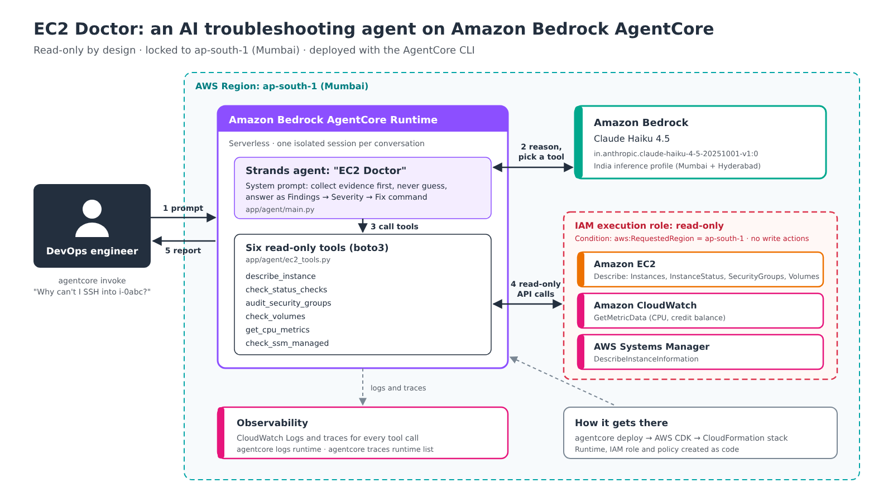

# EC2 Doctor: an EC2 troubleshooting agent on Amazon Bedrock AgentCore

A small AI agent that inspects an EC2 instance, reads its metrics, flags security and
configuration problems, and suggests the exact fix commands.

- **Runtime:** Amazon Bedrock AgentCore Runtime (deployed with the AgentCore CLI)
- **Framework:** Strands Agents (Python)
- **Model:** Claude Haiku 4.5 through the India inference profile
- **Access:** read-only, and only in `ap-south-1` (Mumbai)



## What is in this repo

| Path | What it does |
| --- | --- |
| `app/agent/ec2_tools.py` | Six read-only tools built on boto3 |
| `app/agent/main.py` | The Strands agent, its system prompt and the AgentCore entrypoint |
| `app/agent/model/load.py` | Which Bedrock model the agent uses |
| `agentcore/agentcore.json` | The AgentCore project spec (one runtime, no memory) |
| `agentcore/cdk/lib/cdk-stack.ts` | The IAM statement that gives the agent its read-only access |
| `scripts/pretty.py` | Turns the raw event stream from `agentcore invoke` into readable text |

## Prerequisites

- Node.js 20.12 or later, Python 3.10 or later, and `uv`
- AWS credentials for an account where you can deploy with the AWS CDK
- Access to Claude Haiku 4.5 in Amazon Bedrock

## Run it

```bash
npm install -g @aws/agentcore
git clone https://github.com/avizway1/ec2-doctor-agentcore.git && cd ec2-doctor-agentcore
(cd agentcore/cdk && npm install)
(cd app/agent && uv sync)

export AWS_REGION=ap-south-1

# Test on your machine
agentcore dev

# Deploy
agentcore deploy
agentcore status

# Ask it something
agentcore invoke --runtime agent \
  --payload '{"prompt":"Is instance i-0123456789abcdef0 secure? Review it."}' \
  | python3 scripts/pretty.py
```

## Clean up

```bash
agentcore remove all --yes
agentcore deploy --yes
```

## Use another region

Change `REGION` in `app/agent/ec2_tools.py`, the `aws:RequestedRegion` value in
`agentcore/cdk/lib/cdk-stack.ts`, and the model ID and region in `app/agent/model/load.py`.
