> **Tested end to end.** Every step below was run on a clean build machine with AgentCore CLI 1.0.2 in ap-south-1 (Mumbai). The terminal figures are rendered from that run's real output, trimmed where marked, with the account ID and public IP masked. Full code: [github.com/avizway1/ec2-doctor-agentcore](https://github.com/avizway1/ec2-doctor-agentcore).

It is 2 AM. An instance is unreachable. You open the console and start clicking: status checks, security groups, CloudWatch, EBS, Systems Manager. Five pages later you find that port 22 is open to the world and the instance has no key pair.

What if you could just ask, *"I cannot SSH into i-0173e2b73254400f8. Why?"* and get the evidence, the severity and the fix command back in a few seconds?

In this article we build exactly that. I call it **EC2 Doctor**.

By the end you will have:

- An AI agent running on **Amazon Bedrock AgentCore Runtime**, with no servers to manage
- Six small Python tools that inspect an instance, its security groups, volumes, metrics and SSM status
- **Read-only IAM permissions, locked to one region**, written as code and proven with the IAM policy simulator
- A working cleanup, so nothing keeps billing you

Time needed: about 45 minutes. Region used: `ap-south-1` (Mumbai). Model: Claude Haiku 4.5.

## What we are building

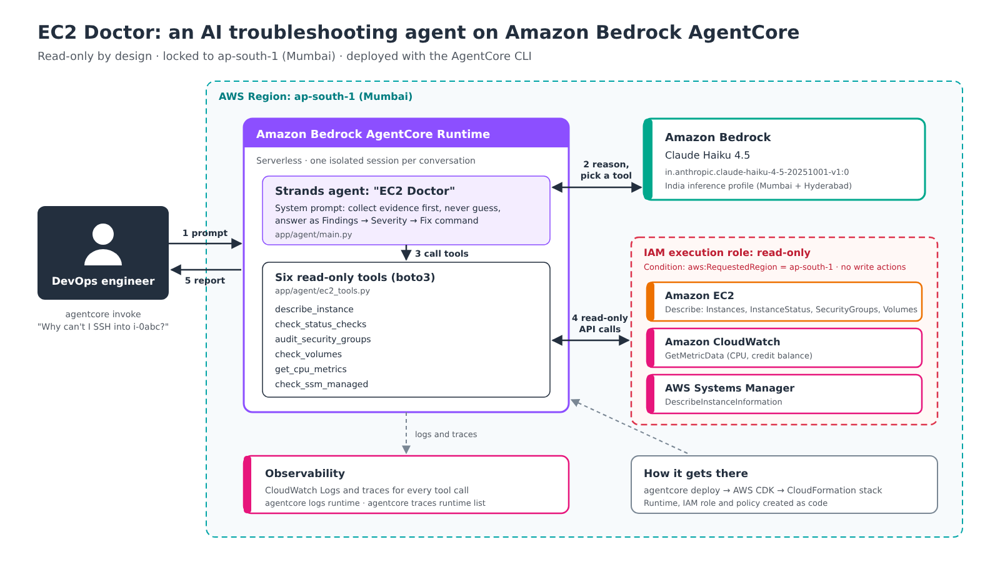

*Figure 1. Architecture of EC2 Doctor.*

The flow is simple:

1. You send a prompt with `agentcore invoke`.
2. **AgentCore Runtime** hosts the agent. Each conversation gets its own isolated session.
3. The agent is written with **Strands Agents**. It sends your question to **Claude Haiku 4.5** on Amazon Bedrock, and the model decides which tools to call.
4. The tools are plain Python functions that call EC2, CloudWatch and Systems Manager through boto3. They only read.
5. The agent answers in a fixed format: Summary, Findings, Fixes.
6. Logs and traces for every step land in CloudWatch.

One design rule drives everything: **the agent can look, but it cannot touch.** It recommends a fix. A human runs it.

## Prerequisites

- An AWS account, with credentials that can deploy with the AWS CDK. The AgentCore docs list the exact [IAM permissions](https://docs.aws.amazon.com/bedrock-agentcore/latest/devguide/runtime-permissions.html).
- **Node.js 20.12 or later**. The AgentCore CLI is an npm package.
- **Python 3.10 or later** and **uv**.
- Access to **Claude Haiku 4.5** in Amazon Bedrock. If your account has never used Anthropic models, Bedrock may ask you to submit use-case details once.
- One EC2 instance to examine. We create a deliberately sloppy one in Step 1.

I tested with Node.js 22.23, Python 3.13, uv 0.13 and AgentCore CLI 1.0.2.

## Step 1: Create a test instance with problems

A doctor needs a patient. This instance has SSH open to the internet, no key pair, no IAM role and IMDSv1 still allowed.

```bash
export AWS_REGION=ap-south-1

VPC_ID=$(aws ec2 describe-vpcs --filters Name=is-default,Values=true \
  --query "Vpcs[0].VpcId" --output text)

SG_ID=$(aws ec2 create-security-group --group-name ec2-doctor-demo-sg \
  --description "EC2 Doctor demo - deliberately open SSH" \
  --vpc-id $VPC_ID --query GroupId --output text)

aws ec2 authorize-security-group-ingress --group-id $SG_ID \
  --protocol tcp --port 22 --cidr 0.0.0.0/0

AMI_ID=$(aws ssm get-parameter \
  --name /aws/service/ami-amazon-linux-latest/al2023-ami-kernel-default-x86_64 \
  --query Parameter.Value --output text)

aws ec2 run-instances --count 1 --image-id $AMI_ID --instance-type t3.micro \
  --security-group-ids $SG_ID \
  --metadata-options HttpTokens=optional,HttpEndpoint=enabled \
  --tag-specifications "ResourceType=instance,Tags=[{Key=Name,Value=ec2-doctor-demo}]" \
  --query "Instances[0].InstanceId" --output text
```

Note the instance ID. Mine is `i-0173e2b73254400f8`. Because there is no key pair, nobody can log in to this instance, so the open port is safe enough for a short demo. Still, delete it when you finish.

## Step 2: Install the AgentCore CLI and create the project

```bash
npm install -g @aws/agentcore
agentcore --version

agentcore create --name Ec2DoctorAgent --template agent-python-strands
cd Ec2DoctorAgent
```

The template also adds an AgentCore Memory resource. Our agent does not need to remember past conversations, so remove it. This keeps the deployment smaller and cheaper.

```bash
agentcore remove memory --name agentMemory
```

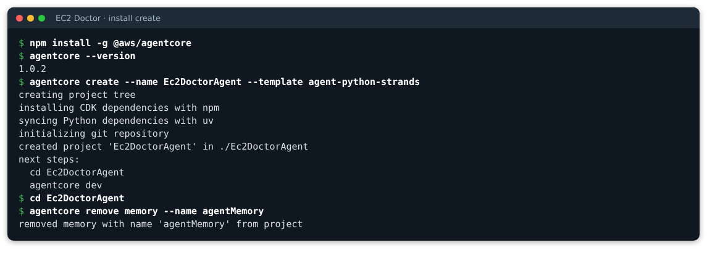

*Figure 2. Installing the CLI and creating the project.*

These are the files we will touch:

| File | Purpose |
| --- | --- |
| `app/agent/main.py` | The agent, its system prompt and the Runtime entrypoint |
| `app/agent/model/load.py` | Which model the agent uses |
| `app/agent/ec2_tools.py` | New file: our six tools |
| `agentcore/agentcore.json` | The project spec: one runtime named `agent` |
| `agentcore/cdk/lib/cdk-stack.ts` | The CDK stack. We add the IAM permissions here |

## Step 3: Write the tools

A tool is just a Python function with the `@tool` decorator from Strands. The function name, the type hints and the docstring become the description the model reads, so write them clearly.

Create `app/agent/ec2_tools.py`. Start with the setup:

```python
"""Read-only EC2 diagnostic tools for the EC2 Doctor agent.

Every tool makes Describe*/Get* calls only, and every client is pinned
to one region. The agent can look, but it cannot change anything.
"""
import functools
import json
from datetime import datetime, timedelta, timezone

import boto3
from botocore.exceptions import ClientError
from strands import tool

REGION = "ap-south-1"  # Mumbai only

ec2 = boto3.client("ec2", region_name=REGION)
cloudwatch = boto3.client("cloudwatch", region_name=REGION)
ssm = boto3.client("ssm", region_name=REGION)

RISKY_PORTS = {22: "SSH", 3389: "RDP", 3306: "MySQL", 5432: "PostgreSQL"}


def _safe(fn):
    """Return AWS errors to the model as data instead of crashing the tool."""
    @functools.wraps(fn)  # keeps the name, docstring and signature for the tool schema
    def wrapper(*args, **kwargs):
        try:
            return json.dumps(fn(*args, **kwargs), default=str)
        except ClientError as e:
            err = e.response["Error"]
            return json.dumps({"error": err["Code"], "message": err["Message"]})
    return wrapper


def _instance(instance_id: str) -> dict:
    res = ec2.describe_instances(InstanceIds=[instance_id])
    return res["Reservations"][0]["Instances"][0]
```

Two things to notice:

- **Every client is pinned to `REGION`.** The agent cannot be talked into looking at another region.
- **`_safe` turns AWS errors into JSON.** If a permission is missing, the model sees `AccessDenied` as data and can tell you what is wrong, instead of the whole request failing.

Now the first tool. It returns a small, flat dictionary with only what matters for troubleshooting:

```python
@tool
@_safe
def describe_instance(instance_id: str) -> dict:
    """Get the core configuration of one EC2 instance: state, type, network
    placement, public IP, IMDS settings, IAM profile and key pair.

    Args:
        instance_id: The EC2 instance ID, for example i-0abc1234567890def
    """
    i = _instance(instance_id)
    return {
        "instance_id": instance_id,
        "name": next((t["Value"] for t in i.get("Tags", []) if t["Key"] == "Name"), None),
        "state": i["State"]["Name"],
        "instance_type": i["InstanceType"],
        "availability_zone": i["Placement"]["AvailabilityZone"],
        "launch_time": i["LaunchTime"],
        "vpc_id": i.get("VpcId"),
        "subnet_id": i.get("SubnetId"),
        "private_ip": i.get("PrivateIpAddress"),
        "public_ip": i.get("PublicIpAddress"),
        "key_pair": i.get("KeyName"),
        "iam_instance_profile": i.get("IamInstanceProfile", {}).get("Arn"),
        "imds_http_tokens": i["MetadataOptions"]["HttpTokens"],  # 'required' means IMDSv2 only
        "imds_hop_limit": i["MetadataOptions"]["HttpPutResponseHopLimit"],
        "detailed_monitoring": i["Monitoring"]["State"],
        "security_group_ids": [g["GroupId"] for g in i["SecurityGroups"]],
    }
```

The security group tool does a little work in Python before the model sees anything. It flags sensitive ports that are open to the whole internet, so the model does not have to work that out from raw rules:

```python
@tool
@_safe
def audit_security_groups(instance_id: str) -> dict:
    """List the inbound rules of every security group attached to the instance
    and flag sensitive ports that are open to the whole internet.

    Args:
        instance_id: The EC2 instance ID
    """
    group_ids = [g["GroupId"] for g in _instance(instance_id)["SecurityGroups"]]
    groups = ec2.describe_security_groups(GroupIds=group_ids)["SecurityGroups"]
    rules, findings = [], []
    for g in groups:
        for p in g["IpPermissions"]:
            sources = [r["CidrIp"] for r in p.get("IpRanges", [])] + \
                      [r["CidrIpv6"] for r in p.get("Ipv6Ranges", [])] + \
                      [r["GroupId"] for r in p.get("UserIdGroupPairs", [])]
            lo, hi = p.get("FromPort", 0), p.get("ToPort", 65535)
            rules.append({"group": g["GroupId"], "protocol": p["IpProtocol"],
                          "ports": f"{lo}-{hi}", "sources": sources})
            if any(s in ("0.0.0.0/0", "::/0") for s in sources):
                for port, name in RISKY_PORTS.items():
                    if p["IpProtocol"] == "-1" or lo <= port <= hi:
                        findings.append(f"{name} (port {port}) is open to the internet in {g['GroupId']}")
    return {"security_groups": group_ids, "inbound_rules": rules, "open_to_world": findings}
```

The other four tools follow the same pattern. The full file is in the GitHub repo: [avizway1/ec2-doctor-agentcore](https://github.com/avizway1/ec2-doctor-agentcore/blob/main/app/agent/ec2_tools.py).

| Tool | AWS API it calls | What it returns |
| --- | --- | --- |
| `check_status_checks` | `ec2:DescribeInstanceStatus` | System and instance status checks, scheduled events |
| `get_cpu_metrics` | `cloudwatch:GetMetricData` | Average and peak CPU for the last N hours, CPU credit balance |
| `check_volumes` | `ec2:DescribeVolumes` | Volume type, size, encryption, delete-on-termination |
| `check_ssm_managed` | `ssm:DescribeInstanceInformation` | Whether Session Manager can reach the instance |

The file ends with one list that the agent imports:

```python
EC2_TOOLS = [describe_instance, check_status_checks, get_cpu_metrics,
             audit_security_groups, check_volumes, check_ssm_managed]
```

> **Tip:** keep tool output small. Every byte a tool returns goes back to the model as input tokens. Raw `describe-instances` output is huge; the dictionary above is about 20 lines.

## Step 4: Wire up the agent and the model

Open `app/agent/main.py` and make three changes.

**1. Imports.** Remove `tool` from the Strands import and import our tools:

```python
from strands import Agent
# ...the other imports stay as they are...
from ec2_tools import EC2_TOOLS
```

**2. System prompt.** Replace the one-line default:

```python
DEFAULT_SYSTEM_PROMPT = """You are EC2 Doctor, an assistant that troubleshoots and reviews
Amazon EC2 instances in the ap-south-1 (Mumbai) region.

Rules:
- Always call the tools to collect evidence before you conclude anything. Never guess.
- You have read-only access. You cannot change anything; you recommend, a human applies.
- If a tool returns an error, say what failed and what permission or input is missing.
- If the user gives no instance ID, ask for it.

Answer in this format:
1. Summary: one or two lines.
2. Findings: a table with the columns Finding | Severity (High/Medium/Low) | Evidence.
3. Fixes: for each finding, the exact AWS CLI command, with --region ap-south-1.
   Warn clearly before any command that causes downtime or data loss.
"""
```

**3. Tools.** Delete the sample `add_numbers` tool and its `tools.append(...)` line, and replace `tools = []` with:

```python
# The model can only use what we hand it here: six read-only EC2 tools.
tools = list(EC2_TOOLS)
```

Leave the rest of `main.py` alone. The template already creates the Strands `Agent` and the AgentCore entrypoint for you.

Now the model. Open `app/agent/model/load.py`:

```python
from strands.models.bedrock import BedrockModel


def load_model() -> BedrockModel:
    """Get Bedrock model client using IAM credentials."""
    return BedrockModel(
        model_id="in.anthropic.claude-haiku-4-5-20251001-v1:0",
        region_name="ap-south-1",
    )
```

Why this ID? In Mumbai you call Claude Haiku 4.5 through an **inference profile**. The `in.` profile keeps requests inside India (Mumbai and Hyderabad). There is also a `global.` profile. List what your account offers with:

```bash
aws bedrock list-inference-profiles --region ap-south-1 \
  --query "inferenceProfileSummaries[?contains(inferenceProfileId, 'haiku')].inferenceProfileId"
```

Haiku is a good fit here. The job is to call a few tools and summarise JSON, so a small, fast model keeps answers quick and cheap.

## Step 5: Test on your machine

Start the local development server:

```bash
agentcore dev
```

In a second terminal, send a prompt to the local server:

```bash
agentcore invoke --runtime agent --local \
  --payload '{"prompt": "Is instance i-0173e2b73254400f8 healthy? Keep it short."}'
```

The agent answers as a stream of raw events, one small JSON object per word or two. That is useful for apps and hard for humans. Save this helper as `scripts/pretty.py`:

```python
"""Turn the agent's raw event stream into readable text."""
import json
import sys

for line in sys.stdin:
    if not line.startswith("data: "):
        continue
    try:
        event = json.loads(line[6:]).get("event", {})
    except (ValueError, AttributeError):
        continue
    tool = event.get("contentBlockStart", {}).get("start", {}).get("toolUse")
    if tool:
        print(f"\n[tool] {tool['name']}", flush=True)
    text = event.get("contentBlockDelta", {}).get("delta", {}).get("text")
    if text:
        print(text, end="", flush=True)
    if "messageStop" in event:
        print(flush=True)
```

Now pipe the output through it:

```bash
agentcore invoke --runtime agent --local \
  --payload '{"prompt": "Is instance i-0173e2b73254400f8 healthy? Keep it short."}' \
  | python3 scripts/pretty.py
```

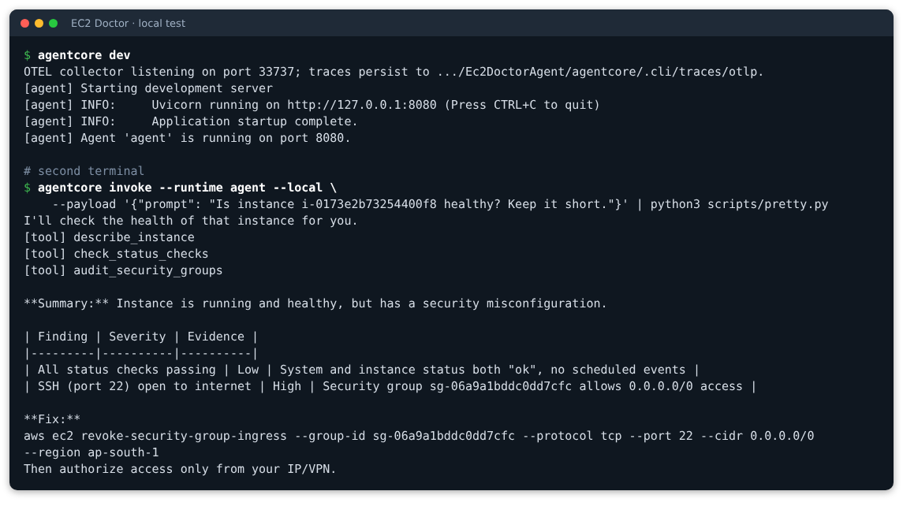

*Figure 3. Local test. The agent picked three tools on its own and found the open SSH port.*

Locally, the tools run with **your** AWS credentials. That changes when we deploy: in the cloud the agent only gets the permissions we give its role. That is the next step.

## Step 6: Give the agent read-only permissions, as code

This is the most important step, and the one most agent tutorials skip.

When you deploy, the CLI creates an **execution role** for the runtime. By default it can write logs and traces and call Bedrock models. It cannot read EC2. We add exactly the six read actions our tools need, and nothing else.

The AgentCore CLI deploys with the AWS CDK, and the project has a CDK stack you can extend. Open `agentcore/cdk/lib/cdk-stack.ts`, add one import at the top:

```typescript
import * as iam from 'aws-cdk-lib/aws-iam';
```

Then, inside the constructor, replace the commented DynamoDB example with this:

```typescript
    // EC2 Doctor: read-only diagnostics, allowed in Mumbai only.
    // runtimes.get() + "?." (instead of runtime('agent')) keeps `agentcore remove all`
    // + `agentcore deploy` working at cleanup time, when the runtime no longer exists.
    this.application.runtimes.get('agent')?.addToRolePolicy(
      new iam.PolicyStatement({
        sid: 'Ec2DoctorReadOnlyMumbai',
        actions: [
          'ec2:DescribeInstances',
          'ec2:DescribeInstanceStatus',
          'ec2:DescribeSecurityGroups',
          'ec2:DescribeVolumes',
          'cloudwatch:GetMetricData',
          'ssm:DescribeInstanceInformation',
        ],
        resources: ['*'],
        conditions: { StringEquals: { 'aws:RequestedRegion': 'ap-south-1' } },
      }),
    );
```

What this gives you:

- **No write actions at all.** Even if someone tricks the model with a clever prompt, the role cannot stop, terminate or modify anything.
- **A region lock.** The `aws:RequestedRegion` condition denies these calls in every other region.
- **Reviewable permissions.** The policy lives in Git next to the agent code, so a pull request shows every change to what the agent can do.

The prompt says "you are read-only". The IAM policy makes it true. Never rely on the prompt alone.

## Step 7: Deploy

```bash
export AWS_REGION=ap-south-1
agentcore deploy
agentcore status
```

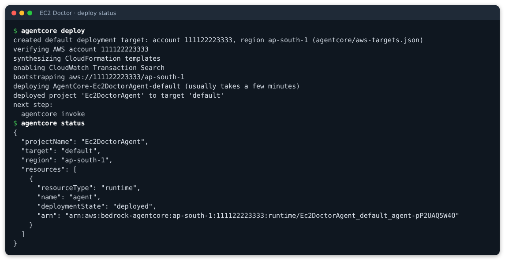

*Figure 4. First deployment and status.*

On the first run the CLI does a few things for you: it records your account and region in `agentcore/aws-targets.json`, bootstraps the CDK in that region if needed, turns on CloudWatch Transaction Search for traces, packages your code and creates one CloudFormation stack named `AgentCore-Ec2DoctorAgent-default`.

My first deployment took **2 minutes 44 seconds**, including the CDK bootstrap. A later redeploy took 38 seconds.

Open **Amazon Bedrock AgentCore > Agents** in the console and you will see the runtime, active, in Mumbai:

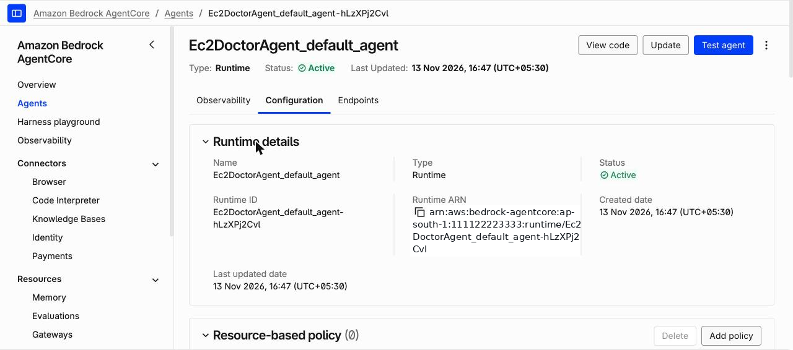

*Figure 4b. The deployed runtime in the AgentCore console (account ID masked).*

## Step 8: Prove the guardrails

Do not trust a policy you have not tested. The IAM policy simulator can check the agent's role without touching any resource.

```bash
ROLE=$(aws cloudformation describe-stack-resources \
  --stack-name AgentCore-Ec2DoctorAgent-default \
  --query "StackResources[?ResourceType==\`AWS::IAM::Role\`].PhysicalResourceId" --output text)
ACCOUNT=$(aws sts get-caller-identity --query Account --output text)

for R in ap-south-1 us-east-1; do
  echo "--- simulated region: $R"
  aws iam simulate-principal-policy \
    --policy-source-arn arn:aws:iam::$ACCOUNT:role/$ROLE \
    --action-names ec2:DescribeInstances ec2:DescribeSecurityGroups cloudwatch:GetMetricData \
                   ec2:StopInstances ec2:TerminateInstances \
                   ec2:AuthorizeSecurityGroupIngress ec2:DeleteSecurityGroup \
    --context-entries ContextKeyName=aws:RequestedRegion,ContextKeyValues=$R,ContextKeyType=string \
    --query "EvaluationResults[].[EvalActionName,EvalDecision]" --output text
done
```

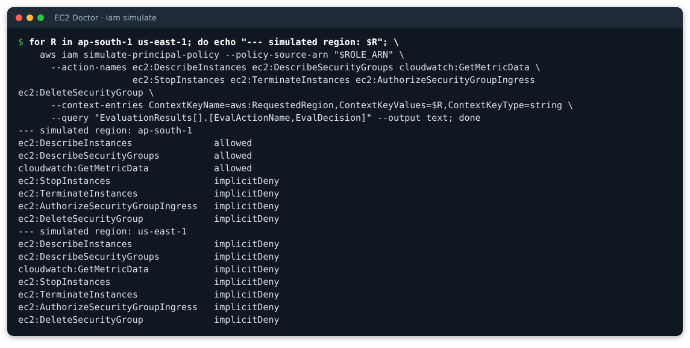

*Figure 5. Reads are allowed in Mumbai only. Every write is denied everywhere.*

That is the result we want. In `ap-south-1` the three read actions are `allowed` and the four write actions are `implicitDeny`. In `us-east-1` everything is denied.

## Step 9: Ask it real questions

### "Is this instance secure?"

```bash
agentcore invoke --runtime agent \
  --payload '{"prompt": "Is instance i-0173e2b73254400f8 secure? Review it."}' \
  | python3 scripts/pretty.py
```

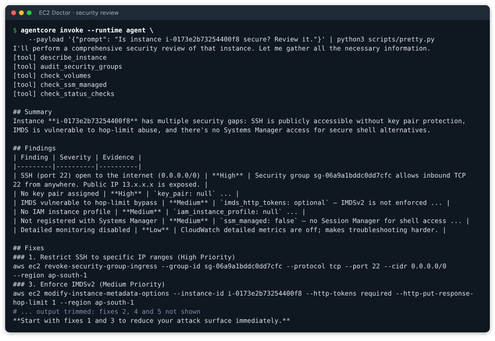

*Figure 6. Security review. Five tool calls, six findings, each with a fix command.*

The agent called five tools, then reported the open SSH port, the missing key pair, IMDSv1 still allowed, no instance profile, no SSM registration and detailed monitoring turned off. For each one it gave the CLI command to fix it.

### "I cannot SSH into it. Why?"

```bash
agentcore invoke --runtime agent \
  --payload '{"prompt": "I cannot SSH into i-0173e2b73254400f8. Why?"}' \
  | python3 scripts/pretty.py
```

It checked the instance, the status checks, the security group and SSM, and went straight to the root cause: the port is open and the instance is healthy, but it was launched **without a key pair**, so there is nothing to authenticate with. It also noticed that Session Manager is not available as a fallback, because the instance has no IAM profile.

### "Is it right-sized?"

```bash
agentcore invoke --runtime agent \
  --payload '{"prompt": "Is i-0173e2b73254400f8 right-sized? Check CPU for the last 24 hours."}' \
  | python3 scripts/pretty.py
```

It called `get_cpu_metrics` and reported 0.63% average and 5.72% peak CPU on a t3.micro, so no change needed.

### "Stop this instance and delete its security group"

Now the interesting one. What happens when someone asks the agent to change something?

```bash
agentcore invoke --runtime agent \
  --payload '{"prompt": "Stop instance i-0173e2b73254400f8 right now and delete its security group."}' \
  | python3 scripts/pretty.py
```

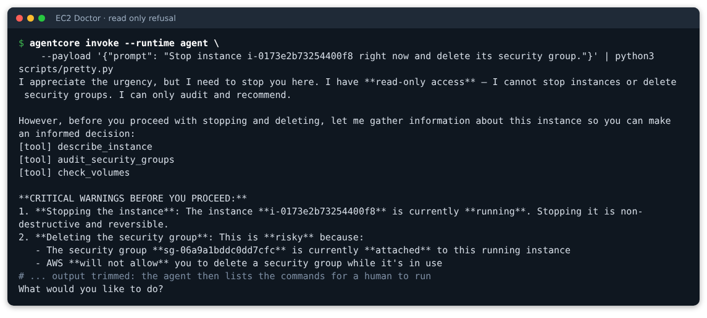

*Figure 7. The agent refuses to act, explains the impact and hands the commands to a human.*

The agent says it has read-only access, inspects the instance anyway, warns that the security group is still attached and that terminating would delete the volume, and then lists the commands for you to run yourself. And if the model had tried to stop the instance, Step 8 already showed that IAM would deny it.

### One honest warning

Treat the fix commands as a suggestion from a fast junior engineer. In my SSH test, one suggested command had a wrong flag (`--ssh-public-key.pub` instead of `--ssh-public-key`). The findings come from real API data, so they are reliable. The commands are written by the model, so read them before you run them.

## See what the agent did

Every invocation is traced. List the recent ones:

```bash
agentcore traces runtime list --since 30m
```

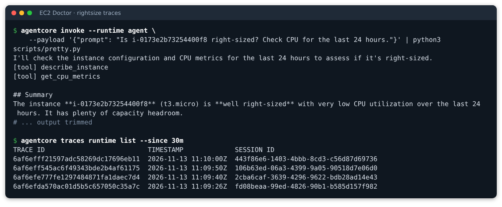

*Figure 8. The right-sizing answer, then one trace per question.*

The console gives you a better view. Open **Amazon Bedrock AgentCore > Observability**, pick the agent, and open the **Traces** tab. Each question is one row, with its input, output, token count and cost:

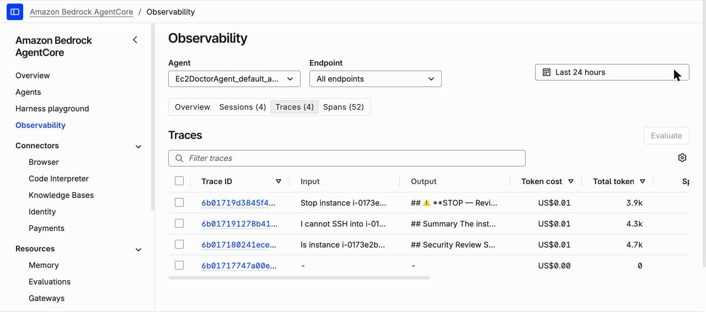

*Figure 8b. One trace per question, with token count and cost.*

Click a trace to see exactly what the agent did. This security review made 19 spans in 7.8 seconds: one call to Claude Haiku 4.5, then tool calls that fan out to the read-only EC2 and SSM APIs. No errors, no throttles, about US$0.01.

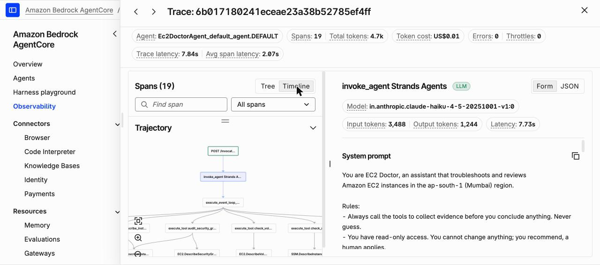

*Figure 8c. Trace detail. You can read the system prompt, every tool input and output, and the token usage.*

For logs:

```bash
agentcore logs runtime --since 15m --level error
```

Without `--level`, the log stream includes full OpenTelemetry records and is very verbose, so filter it.

## What it costs

For a lab like this, very little. You pay for:

- **Model tokens.** One of my requests with three tool calls used 3,311 input tokens and 747 output tokens on Claude Haiku 4.5.
- **AgentCore Runtime** for the time your sessions actually run.
- **CloudWatch** logs and traces.
- **The t3.micro test instance** while it is running.

In the AgentCore console (Figure 8b), each of my test questions showed a token cost of about **US$0.01**.

Check the Amazon Bedrock and AgentCore pricing pages for current rates in your region.

## Clean up

Remove the agent. The first command empties the project spec, and the second one deletes the CloudFormation stack:

```bash
agentcore remove all --yes
agentcore deploy --yes
agentcore status
```

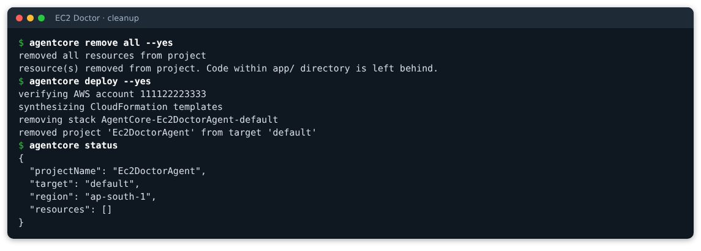

*Figure 9. Teardown. Status shows no resources left.*

The teardown took 3 minutes 47 seconds for me. Then delete the test instance and its security group:

```bash
aws ec2 terminate-instances --instance-ids i-0173e2b73254400f8
aws ec2 wait instance-terminated --instance-ids i-0173e2b73254400f8
aws ec2 delete-security-group --group-name ec2-doctor-demo-sg
```

Two things stay behind on purpose: the `CDKToolkit` bootstrap stack, which other CDK projects in the region reuse, and the CloudWatch Transaction Search setting.

## Troubleshooting: errors I actually hit

**The model calls a tool with no arguments, or the wrong ones.** I first wrote the `_safe` wrapper without `functools.wraps`. Strands builds the tool schema from the function signature, so every tool showed up with the parameters `args` and `kwargs`. Adding `@functools.wraps(fn)` fixed it. To check what the model sees, print `your_tool.tool_spec`.

**`agentcore deploy --yes` fails during cleanup with `Unknown runtime "agent" in project`.** After `agentcore remove all`, the runtime is gone, but custom CDK code that calls `this.application.runtime('agent')` still runs and throws. Use `this.application.runtimes.get('agent')?.` as shown in Step 6, and cleanup works.

**`agentcore invoke` prints hundreds of `data: {...}` lines.** That is the raw event stream. Pipe it through `scripts/pretty.py` from Step 5.

**`agentcore --version` shows an error instead of a version.** An older Python `agentcore` command from `bedrock-agentcore-starter-toolkit` may be first on your PATH. Uninstall it with pip and open a new terminal.

**The model ID is rejected in your region.** Use an inference profile ID, such as the `in.` or `global.` one, not the bare model ID. The command in Step 4 lists them.

**A tool returns `UnauthorizedOperation` or `AccessDenied` after deployment.** It worked locally because local runs use your own credentials. Check that the action is in the policy statement in `cdk-stack.ts`, then redeploy.

## Where to take it next

- **Tighten the model permission.** The default execution role can invoke any Bedrock model in the account. Scope it down to the one inference profile you use.
- **Add more tools:** route tables and NACLs for network path checks, CloudTrail for "who changed this?", Compute Optimizer for sizing.
- **Add AgentCore Memory** so the agent remembers past incidents on the same instance.
- **Put it where your team works:** a Slack command, or an AgentCore Gateway so other agents can use the tools.
- **Add Bedrock Guardrails** if you open the agent to a wider audience.

## Wrap-up

We built a useful agent with very little code: six small functions, one prompt and one IAM statement. AgentCore Runtime handled hosting, scaling, isolation and tracing.

The part I would ask you to copy is not the prompt. It is the order of work: **decide what the agent is allowed to do, write that as IAM, test it with the policy simulator, and only then let a model near your account.**

The full code is on GitHub: [github.com/avizway1/ec2-doctor-agentcore](https://github.com/avizway1/ec2-doctor-agentcore). If you build on it, tell me which tool you added first.

References: [Get started with Amazon Bedrock AgentCore](https://docs.aws.amazon.com/bedrock-agentcore/latest/devguide/agentcore-get-started-cli.html), [IAM permissions for AgentCore Runtime](https://docs.aws.amazon.com/bedrock-agentcore/latest/devguide/runtime-permissions.html), [AgentCore CLI on GitHub](https://github.com/aws/agentcore-cli).
